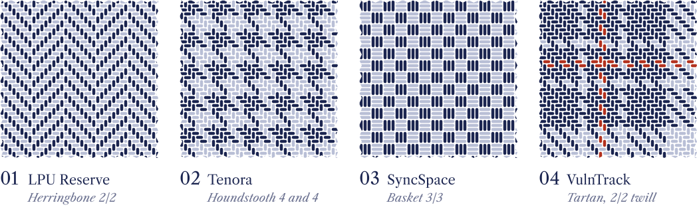
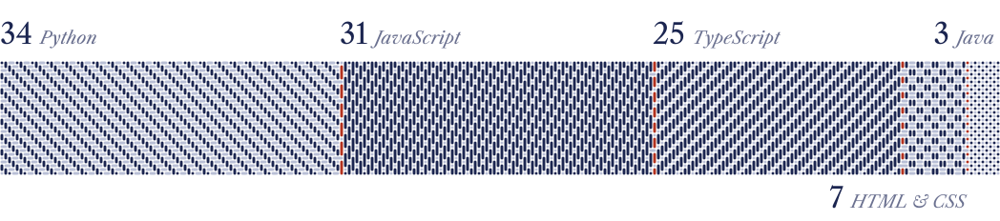
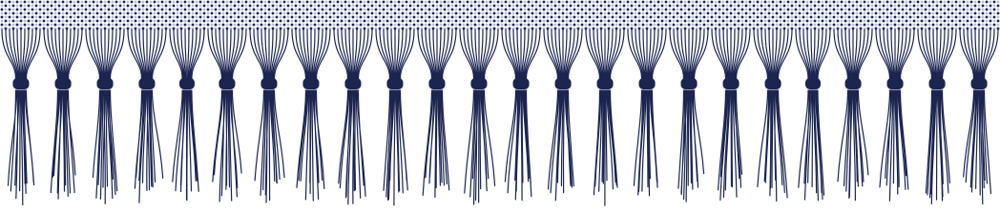

<picture>
  <source media="(prefers-color-scheme: dark)" srcset="assets/masthead-dark.svg">
  
</picture>

**Software engineer.** Final-year B.Tech in Computer Science at Lovely Professional University.

I build web systems in Python and TypeScript/JavaScript, and I spend most of my effort where software fails quietly: two requests arriving at once, a webhook delivered twice, a tenant reading another tenant's rows, an edit made offline. Where I can, the rule lives in the database rather than in a check in front of it. A test races to prove it, and the README says plainly what isn't finished.

> We may say most aptly, that the Analytical Engine weaves algebraical patterns just as the Jacquard-loom weaves flowers and leaves.
>
> Ada Lovelace, Note A, 1843

<b>How the pictures on this page are made</b>

 

Every image here is computed cloth: it's rendered thread by thread from a weave, not drawn.

A weave on a shaft loom is three Boolean matrices. The *threading* puts each warp end on a shaft, the *tie-up* says which shafts each treadle lifts, and the *treadling* says which treadle is pressed for each pick of weft. Their product is the cloth: `D = P · Uᵀ · Tᵀ` over the Boolean semiring. In the drawing below, the highlighted row steps through that product one pick at a time.

<picture>
  <source media="(prefers-color-scheme: dark)" srcset="assets/draft-dark.svg">
  
</picture>

The masthead is a Jacquard weave, which skips shafts and lifts every end by its own rule. The rule is an eight-end warp-faced satin where the letters fall and a weft-faced satin everywhere else. The type is Libre Caslon: it's quantised onto the thread grid for the masthead and set as outlines everywhere else. The generator is in [`studio/`](studio).

## Selected work

<picture>
  <source media="(prefers-color-scheme: dark)" srcset="assets/samples-dark.svg">
  
</picture>

### 01 · [LPU Reserve](https://github.com/swastikongithub/Django-EduRev-P20)

Booking for every bookable thing on a university campus: classrooms, labs, halls, courts, equipment and vehicles. Built from the EduRev P20 specification.

- Double-booking is refused by PostgreSQL itself, through an exclusion constraint on each resource's booking periods. A CI test fires 500 simultaneous attempts at one slot and expects exactly one booking.
- Timetabled classes and maintenance windows sit on the same ledger, so a booking can't overlap them either.
- Includes QR check-in, automatic release of no-shows, approval chains that are edited as data rather than deployed, and TOTP MFA for staff.
- CI runs Playwright journeys, axe accessibility checks, pip-audit, gitleaks and an OWASP ZAP baseline.

Django 5.2 · PostgreSQL 16 · Celery · Redis · htmx · Docker · GitHub Actions 
[Live demo](https://django-edurev-p20.onrender.com) · [How double-booking is ruled out](https://github.com/swastikongithub/Django-EduRev-P20/blob/main/docs/booking-concurrency.md)

### 02 · [Tenora](https://github.com/swastikongithub/Tenora)

Multi-tenant billing for property owners: leases, meters and tariffs, monthly bills, receipts and online payments, plus Tenora's own subscription billing.

- Two money flows are kept apart down to the table: owners paying Tenora, and residents paying owners. Each has its own app, gateway adapter and webhook route.
- Idempotency is a unique constraint, not a check: one payment per provider capture, one subscription per tenant, and webhook deliveries deduplicated. Signatures are verified on the raw body before anything is parsed.
- The tenant comes only from a header plus an active membership. Cross-tenant access answers 404, never 403.
- 961 backend and 557 frontend tests. Concurrency is tested with real threads on real database connections.

Python 3.12 · Django 5 · DRF · PostgreSQL · Celery · Redis · Cashfree · React 19 · TypeScript · TanStack Query 
[Live app](https://tenora-frontend.onrender.com) (free tier, so the first request can take about 30 s)

### 03 · [SyncSpace](https://github.com/swastikongithub/SyncSpace)

Offline-first collaborative documents. People edit together in real time, keep editing with no connection, and converge when it returns.

- Yjs CRDTs over WebSockets. IndexedDB and a service worker keep opened documents editable offline, even after a reload.
- The interface says a change is stored on the server only after MongoDB has written it.
- Convergence is tested with 300 randomised CRDT runs and 15 whole-system runs that mix network loss with simulated server crashes.
- Measured over loopback on one machine, an edit reaches four collaborators in 5.0–5.8 ms at p50.

React · Node.js · Express · MongoDB · Yjs · TipTap · WebSockets · Playwright

### 04 · [VulnTrack](https://github.com/swastikongithub/VulnTrack)

Vulnerability management for organisations: asset and software inventory, public advisories, and the matches between them. Still in progress.

- Ingests advisories from NVD and OSV through source adapters into one normalised model, with CVSS, CWE, affected packages and CISA known-exploited status.
- Matches inventory to advisories by canonical package identity (Package URL), per-ecosystem version comparison and OSV range evaluation. Each match carries its reason and confidence.
- Multi-tenant organisations with a central permission model, owner and admin hierarchy, and invitations.

Node.js · Express · MongoDB · Zod · React 19 · Vite · Vitest

#### Also in progress

[**ClearSettle**](https://github.com/swastikongithub/ClearSettle) is payment reconciliation and double-entry accounting for India. So far it has the authentication foundation: Spring Boot 4.1 on Java 21, Keycloak OIDC with PKCE, server-side sessions and step-up MFA, with each decision written up as an ADR.

## Composition

<picture>
  <source media="(prefers-color-scheme: dark)" srcset="assets/composition-dark.svg">
  
</picture>

Python 34% · JavaScript 31% · TypeScript 25% · HTML & CSS 7% · Java 3%. Measured as non-blank lines of code across seven public repositories (Django-EduRev-P20, Tenora, SyncSpace, VulnTrack, ClearSettle, ai-interview-platform, email-job-scheduler). Docs, migrations, lockfiles, and minified or vendored files are excluded.

Also used in these repositories: Django, DRF, Celery, Spring Boot, Express, React, Next.js, PostgreSQL, MongoDB, Redis, Docker, GitHub Actions, pytest, Vitest and Playwright.

## Contact

Open to software engineering roles.

[swastiksingh288@gmail.com](mailto:swastiksingh288@gmail.com) · [LinkedIn](https://www.linkedin.com/in/swastiksin/) · [swastik.fun](https://swastik.fun) · [Résumé](https://swastik.fun/swastik-singh-resume.pdf)

<picture>
  <source media="(prefers-color-scheme: dark)" srcset="assets/fringe-dark.svg">
  
</picture>
